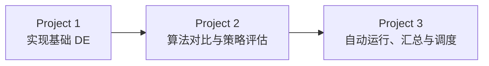

<div align="center">

# Lab for Embedded Systems Scripting

**差分进化 · 算法对比与消融 · Linux 实验自动化**

[English](./README.md) · **简体中文**


从基础优化算法实现，到改进方法的实验评估，再到 Linux 下的自动运行与结果汇总。

</div>

---

**快速导航：**[项目概览](#overview) · [环境准备](#setup) · [Project 1](#project-1) · [Project 2](#project-2) · [Project 3](#project-3) · [输出与上传范围](#outputs)

<a id="overview"></a>
## 项目概览

本仓库包含 **Embedded Systems Scripting（嵌入式脚本开发）** 课程的三个关联项目：使用 Python 实现和评估差分进化算法（Differential Evolution，DE），再通过 Bash 和 Cron 完成实验自动化。

| 项目 | 课程目标 | 仓库提供的内容 |
| :--- | :--- | :--- |
| [Project&nbsp;1](./project_1/) | 实现基础 DE，进行多次独立运行与统计分析 | DE/rand/1/bin、CEC2014 实验、统计汇总与收敛曲线 |
| [Project&nbsp;2](./project_2/) | 实现改进 DE 方法，组合策略并评估各模块作用 | 六种算法对比、NICE-DE、四组消融变体与对比曲线 |
| [Project&nbsp;3](./project_3/) | 在 Linux 下自动执行 Project 2 程序并分析日志 | 参数遍历、按批次保存、grep/awk 汇总与每小时 Cron 调度 |



仓库上传 **源代码、配置和使用说明**。实验结果、生成图表、运行日志及课程取证材料保留在本地。

### 目录结构

```text
.
├── README.md                       # English
├── README.zh-CN.md                 # 简体中文
├── project_1/
│   ├── de.py                       # 基础 DE/rand/1/bin
│   ├── run_cec2014.py               # 多次独立运行与统计
│   ├── plot_convergence.py
│   └── schwefel_patch.py
├── project_2/
│   ├── common/                     # 公共实验框架与测试函数修补
│   ├── methods/                    # 对比算法、NICE-DE 与消融变体
│   └── plot_convergence.py
└── project_3/
    ├── run_experiments.sh           # Bash 调度与结果提取
    ├── run_nice_p3.py               # 复用 Project 2 NICE-DE 的入口
    ├── install_env.sh
    ├── run_nohup.sh
    ├── check_cron_evidence.sh
    ├── crontab.example
    └── USAGE.txt
```

<a id="setup"></a>
## 环境准备

克隆仓库并创建 Python 环境。以下命令适用于 macOS/Linux 终端，后续 Project 1/2 命令均从仓库根目录执行：

```bash
git clone https://github.com/Whelve-Autism/Lab-for-Embedded-Systems-Scripting.git
cd Lab-for-Embedded-Systems-Scripting

python3 -m venv .venv
source .venv/bin/activate
python -m pip install -r project_2/requirements.txt scipy cma matplotlib
```

| 依赖 | 用途 |
| :--- | :--- |
| NumPy、pandas | 数值计算与实验结果表 |
| opfunu 1.0.1 | CEC2014 测试函数 |
| SciPy | DE-VCR 与 ECL-SPACMA 中的相关组件 |
| cma | NICE-DE 的 CMA-ES 局部搜索 |
| Matplotlib | 收敛曲线绘制与 PDF 导出 |

项目依赖保留了 `setuptools<81`，用于兼容测试函数库。安装命令中额外列出的依赖覆盖具体算法和绘图所需的模块。Project 3 另有独立环境安装脚本，见下文。

### 默认实验协议

| 设置 | Project 1 与 Project 2 | Project 3 |
| :--- | :--- | :--- |
| 测试集 | CEC2014，F1–F30 | CEC2014，F1–F30 |
| 维度 / 搜索范围 | 10 / [−100, 100] | 10 / [−100, 100] |
| 评估预算 | 每个函数、每个种子 100,000 次 | 每个函数 20,000 / 50,000 / 100,000 次 |
| 随机种子 | 1001–1020，每个函数独立运行 20 次 | 1001，每个函数、每组配置运行一次 |
| 误差指标 | `f(x_best) - f*` | 对全部函数的 `abs(f(x_best) - f*)` 求均值 |
| 种群设置 | Project 1 为 100；Project 2 由各算法决定 | NICE-DE 为 100 |

预算按 **目标函数评估次数（FEs）** 计算。各算法的种群参数与调整策略见对应实现，比较实验应同时记录这些设置。与原论文结果对照时，还需对应原论文使用的测试集、维度和实验条件。

<a id="project-1"></a>
## Project 1 · 基础差分进化

[源码目录](./project_1/) · [实验入口](./project_1/run_cec2014.py)

实现 **DE/rand/1/bin**：种群规模为 100，变异因子为 0.5，交叉概率为 0.9。对每个 CEC2014 测试函数使用 20 个随机种子分别运行。

```bash
python project_1/run_cec2014.py --workers 8
python project_1/plot_convergence.py
```

输出包括 **Best、Median、Mean、Worst 和 Std**，同时保存每次运行的最终误差与收敛记录。`Std` 为样本标准差；如报告需要样本方差，可对标准差平方。

绘图脚本在 `project_1/out/plot/` 下生成 30 张 PDF，展示误差中位数曲线及四分位区间。两个项目的绘图脚本均指定 **Times New Roman**；绘图设备上需要有该字体，才能保持预期样式。

<a id="project-2"></a>
## Project 2 · 改进算法与策略评估

[源码目录](./project_2/) · [公共实验框架](./project_2/common/experiment.py)

### 主实验

| 算法 | 定位 | 运行入口 |
| :--- | :--- | :--- |
| BIDE | 基础 DE/rand/1/bin 对比算法 | [run.py](./project_2/methods/BIDE/run.py) |
| DLS-DE | 改进 DE 对比算法 | [run.py](./project_2/methods/DLS_DE/run.py) |
| DE-VCR | 改进 DE 对比算法 | [run.py](./project_2/methods/DE_VCR/run.py) |
| ECL-SPACMA | 混合对比算法，本实现使用 SLSQP 局部搜索 | [run.py](./project_2/methods/ECL_SPACMA/run.py) |
| iStratDE | 个体级策略多样化方法的 NumPy 实现 | [run.py](./project_2/methods/iStratDE/run.py) |
| **NICE-DE** | 小组构建的方法，结合自适应 DE 与小生境引导的 CMA-ES 搜索 | [run.py](./project_2/methods/NICE_DE/run.py) |

在仓库根目录运行六种算法的主实验：

```bash
for method in BIDE DLS_DE DE_VCR ECL_SPACMA iStratDE NICE_DE; do
  python "project_2/methods/${method}/run.py" --workers 8
done
```

### NICE-DE 与消融实验

**NICE-DE** 全称为 *Niche-Informed Covariance-Enhanced Differential Evolution*。它结合自适应 DE 全局搜索、小生境引导的持久 CMA-ES 局部搜索，以及两者之间的信息交换。局部搜索消耗计入同一总 FE 预算。

| 消融变体目录 | 移除的机制 |
| :--- | :--- |
| [`NICE_wo_Niche`](./project_2/methods/NICE_wo_Niche/) | 小生境对局部搜索区域选择的引导 |
| [`NICE_wo_Persistence`](./project_2/methods/NICE_wo_Persistence/) | CMA-ES 状态在不同代之间的持续保留 |
| [`NICE_wo_Collaboration`](./project_2/methods/NICE_wo_Collaboration/) | CMA 向 DE 的解注入，以及 CMA 对输出全局最优值的贡献 |
| [`NICE_wo_LocalSearch`](./project_2/methods/NICE_wo_LocalSearch/) | CMA-ES 局部搜索；可用 FE 预算交由 DE 使用 |

```bash
for variant in NICE_wo_Niche NICE_wo_Persistence NICE_wo_Collaboration NICE_wo_LocalSearch; do
  python "project_2/methods/${variant}/run.py" --workers 8
done

python project_2/plot_convergence.py --pack all
```

绘图命令读取主实验和消融实验的 CSV，在 `project_2/out/plot/main/` 与 `project_2/out/plot/ablation/` 生成样式一致的 PDF。逐次运行的 CSV 也用于整理报告中的统计表和算法排名。

<a id="project-3"></a>
## Project 3 · Bash 自动化与实验分析

[源码目录](./project_3/) · [详细使用说明](./project_3/USAGE.txt) · [Cron 配置](./project_3/crontab.example)

Project 3 通过一个轻量 Python 入口复用 **Project 2 的 NICE-DE 实现**。Bash 循环改变 FE 预算，将程序输出追加到日志，再通过 `grep | awk` 为每组配置提取一个数值结果。

### 在 Linux 下运行

保留 `project_2` 与 `project_3` 的平级目录关系。安装脚本会在 `project_3/.venv` 下创建环境：

```bash
cd project_3
chmod +x install_env.sh run_experiments.sh run_nohup.sh check_cron_evidence.sh
./install_env.sh
./run_experiments.sh
```

默认配置为：**三个 FE 预算、30 个函数、随机种子 1001、16 个工作进程**。NICE-DE 使用 CPU 计算，设置 `CUDA_VISIBLE_DEVICES` 不会让算法转为 GPU 计算。

如需先检查小规模流程，可单独生成一个手动批次：

```bash
FE_LIST="2000" FUNCS="1-2" WORKERS=2 ./run_experiments.sh
```

这一子集检查不能替代完整课程实验，也不计入要求的定时执行次数。

### 汇总指标与日志提取

对每个 FE 预算，分别运行全部要求的测试函数一次，并计算：

$$
E_{\mathrm{mean}} = \frac{1}{30}\sum_{i=1}^{30}\left|f_i(x_{\mathrm{best},i}) - f_i^{\star}\right|.
$$

若只选择函数子集，分母相应改为所选函数数量。只有全部所选函数成功完成，才输出有效汇总值。

| 日志记录或文件 | 用途 |
| :--- | :--- |
| `BATCH_START` / `BATCH_END` | 批次起止时间与完成状态 |
| `RUN_START` / `RUN_END` | 配置编号、参数及退出状态 |
| `P3_RESULT` | 便于提取的数值结果、函数数量与失败数量 |
| `experiment.log` | 追加保存 Python 输出及实验记录 |
| `summary_report.txt` | 最新批次的提取结果，以及对应原始结果行 |

每次调用创建独立批次目录并保留该批次的汇总。最新汇总按当前批次编号筛选，避免混入旧日志记录。输入无效或配置运行失败时返回非零退出状态；失败配置不会被包装成有效的部分函数均值。

### 每小时 Cron 调度

先修改 [crontab.example](./project_3/crontab.example) 中的绝对路径，再通过 `crontab -e` 安装。通用格式如下：

```cron
0 * * * * PYTHON_BIN="/absolute/path/project_3/.venv/bin/python" WORKERS=16 /bin/bash "/absolute/path/project_3/run_experiments.sh" >> "/absolute/path/project_3/cron_execution.log" 2>&1
```

保持 Linux 运行，直到 **至少三个定时批次成功完成**。核对不同批次编号、时间戳、保存的结果与成功的 `BATCH_END` 记录。手动运行和子集检查不计入定时执行次数。重复使用种子 1001 用于验证自动调度，不增加新的独立随机种子。

课程提交材料应保留 Cron 配置、脚本、带时间戳的日志、结果汇总和真实终端截图，并展示命令行文本编辑器、可执行权限、帮助或手册、输入与错误检查，解释所用日志格式。相关命令及手动重新运行方式见 [USAGE.txt](./project_3/USAGE.txt)。收集完所需证据后，停用测试用定时任务。

<a id="outputs"></a>
## 输出与上传范围

以下内容由程序在本地生成，不上传到 Git：

| 路径 | 内容 |
| :--- | :--- |
| `project_1/out/` | 逐次运行 CSV、统计汇总与收敛图 PDF |
| `project_2/out/<method>/` | 各算法结果、实验协议、曲线与可用诊断记录 |
| `project_2/out/plot/` | 主实验与消融实验 PDF |
| `project_3/results/P3/<batch_id>/` | 各预算结果及对应批次汇总 |
| Project 3 日志、`archive/`、`screenshots/` | 执行记录与课程取证材料 |
| `.venv/`、`__pycache__/` | 本地环境与 Python 缓存 |

Project 1/2 的运行入口使用固定输出路径。Project 3 按批次分别保存；其 `--clean` 选项会归档汇总日志，**随后启动一个新批次**。每小时 Cron 任务中不要使用 `--clean`。

空的 `.gitkeep` 文件仅用于保留 Project 3 的结果与取证目录结构。课程报告与原始参考 PDF 单独保存，不随本源码仓库上传。
